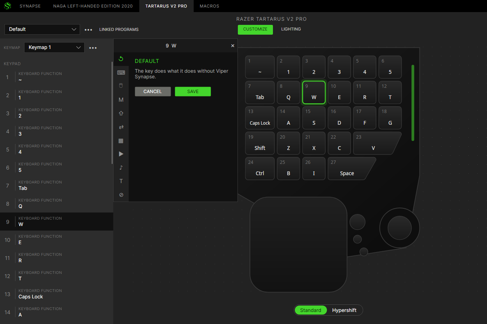
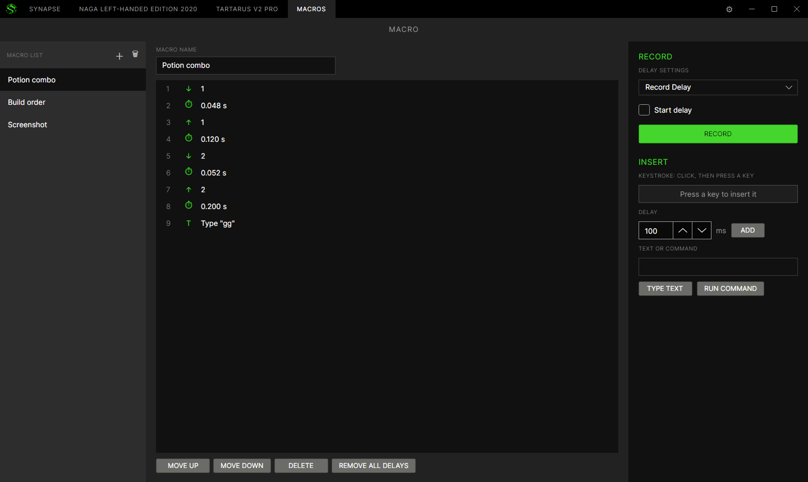
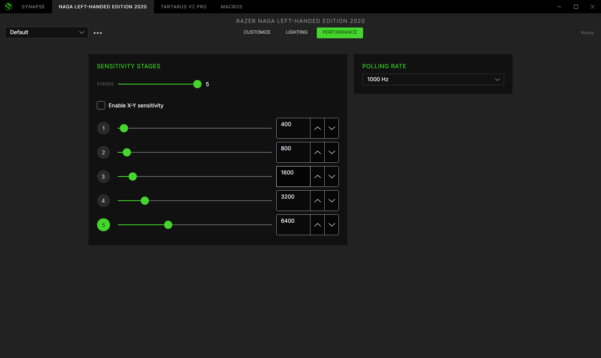

<p align="center"></p>

# Viper Synapse

A Razer Synapse–style control centre for Razer keyboards, keypads and mice on Linux: key and button
remapping, Hypershift, macros, lighting, sensitivity stages, polling rate and power settings, in a window
that feels like the one you know.

Viper Synapse talks to devices directly over hidraw using Razer's control protocol, so it needs no kernel
module and no other daemon. Remaps and macros run in user space through evdev and uinput, so they work the
same on Wayland and X11.

<p align="center"></p>

## What it does

- **Customize** — rebind any key or button: keyboard functions with modifiers, mouse functions, turbo,
  macros, Razer Hypershift (a second layer while a key is held), switch profile or keymap, launch a
  program, type text, multimedia keys, or disable the key. Up to eight keymaps per profile.
- **Macros** — record with Synapse's three delay settings (record delay, default delay, no delay) and an
  optional start countdown; edit the action list (keystrokes, delays, text, commands, reorder); play once,
  a set number of times, while held, or toggle on and off.
- **Lighting** — brightness and quick effects per zone: static, breathing, spectrum cycling, wave,
  reactive, starlight, wheel.
- **Performance** — up to five sensitivity stages with optional separate X and Y, and the polling rate.
- **Power** — sleep timer and low-battery threshold on wireless mice.
- **Profiles** — per device, switched by hand, by a key, or automatically while a linked program is in
  front (KDE Plasma, Hyprland and X11 desktops).
- **Starts at sign-in** if you want it to (off by default), and lives in the tray.

<p align="center">
  
  
</p>

## Devices

The device catalogue covers 270+ Razer models (from OpenRazer's device data) plus our own entries.
Tested on real hardware so far:

| Device | Status |
| --- | --- |
| Tartarus V2 Pro | keys, Hypershift layer, macros, lighting — tested |
| Naga Left-Handed Edition 2020 | buttons, side grid, lighting, sensitivity, polling — tested |
| Basilisk V4 Pro | planned (wired and HyperSpeed) |

Other models in the catalogue are marked as untested in the app until someone confirms them.

## Install

**Arch Linux (AUR):** `viper-synapse-bin`

**Debian / Ubuntu:** download the `.deb` from the releases page and install it with
`sudo apt install ./viper-synapse_*.deb`. Tested on Debian 12 and 13 and Ubuntu 22.04 and 24.04.

**Anywhere else:** extract the `linux-x64` tarball and run `./viper-synapse`. Install the udev rule once
(the packages do this for you):

```sh
sudo install -m644 70-viper-synapse.rules /etc/udev/rules.d/
sudo modprobe uinput
sudo udevadm control --reload && sudo udevadm trigger
```

The rule gives the logged-in user access to Razer devices and to `/dev/uinput`, nothing more.

## Building

Requires the .NET 10 SDK.

```sh
dotnet build ViperSynapse.slnx -c Release
dotnet test ViperSynapse.slnx -c Release
packaging/build-release.sh          # tarball and .deb in packaging/out
```

`viper-cli list` shows the Razer devices it can see; `viper-cli probe /dev/hidrawN` reads a device's
serial, firmware and settings without changing anything.

## Acknowledgements

The [OpenRazer](https://openrazer.github.io/) project documented the Razer control protocol that this work
builds on, and its device data seeds the catalogue.

Viper Synapse is an independent project. It is not affiliated with or endorsed by Razer Inc. "Razer" and
"Synapse" are trademarks of Razer Inc. Device photos are fetched from Razer's own servers at run time and
are not part of this repository.

## Licence

GPL-3.0-or-later. See [LICENSE](LICENSE).
